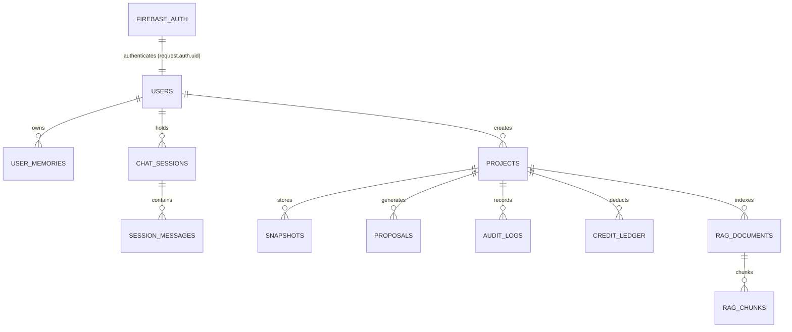

# Rewind — Firebase Database Architecture & Schema Specification

This document provides the complete database design, collection schemas, entity relationships, security rules, TypeScript interfaces, and bootstrap scripts required to run Rewind with multi-tenant **Firebase Authentication**, **Cloud Firestore**, and **Per-User Memory**.

---

## 1. Architectural Overview

Firebase does not use relational SQL tables; it uses **Firebase Authentication** for identity management and **Cloud Firestore** (NoSQL hierarchical collections and documents) for data persistence.



### Relational SQL vs. Firebase Firestore Concept Mapping

| SQL Relational Concept | Firebase / Cloud Firestore Equivalent | Rewind Implementation |
|---|---|---|
| **Database** | Firestore Database (`(default)`) | Project-level database instance |
| **Table** | Collection or Subcollection | `users`, `projects`, `snapshots`, `memories` |
| **Row / Record** | Document | JSON-like document with strongly-typed fields |
| **Column** | Document Field | `string`, `number`, `boolean`, `timestamp`, `map`, `array` |
| **Primary Key (PK)** | Document ID | `userId` (UID), `snap_{timestamp}_{hash}`, `taskId` |
| **Foreign Key (FK)** | Path Hierarchy or Document Reference | Subcollection path nesting (`/users/{uid}/projects/{pid}/...`) |
| **User / Auth Table** | Firebase Authentication Service | Managed identity with password hashing, OAuth, & JWTs |

---

## 2. Complete Database Schemas & Collections

### Table 1: Authentication & User Accounts
- **Identity Provider:** Firebase Authentication
- **Firestore Document Path:** `/users/{userId}`
- **Primary Key / Document ID:** `userId` (matches `request.auth.uid`)

| Field Name | Type | Required | Default | Description |
|---|---|:---:|---|---|
| `uid` | `string` | Yes | — | Unique user identifier from Firebase Auth |
| `email` | `string` | Yes | — | Verified email address |
| `displayName` | `string` | Yes | `""` | User's full display name |
| `photoURL` | `string` | No | `null` | Profile photo or avatar URL |
| `role` | `string` | Yes | `"developer"` | Access role: `"admin" \| "developer" \| "viewer"` |
| `activeProjectId` | `string` | Yes | `"demo-workspace"` | Pointer to user's currently selected project |
| `creditAllowance` | `number` | Yes | `100` | Free Rewind Credits allowance limit |
| `creditsUsed` | `number` | Yes | `0` | Cumulative credits consumed |
| `createdAt` | `timestamp` | Yes | `serverTimestamp()` | Account registration date |
| `updatedAt` | `timestamp` | Yes | `serverTimestamp()` | Profile last modified date |

---

### Table 2: User-Wise Memory & Developer Context
Stores persistent long-term memory, learned coding conventions, frequently repaired compiler errors, and custom agent rules.
- **Firestore Document Path:** `/users/{userId}/memories/{memoryId}`
- **Primary Key / Document ID:** `memoryId` (`mem_{timestamp}_{hash}`)

| Field Name | Type | Required | Description |
|---|---|:---:|---|
| `id` | `string` | Yes | Unique memory ID |
| `userId` | `string` | Yes | Owner user reference |
| `projectId` | `string` | No | Optional project-scoped filter (or global if null) |
| `type` | `string` | Yes | Category: `"coding_preference" \| "frequent_error_fix" \| "architectural_rule"` |
| `title` | `string` | Yes | Short summary (e.g. *"Strict TypeScript interfaces"*) |
| `content` | `string` | Yes | Full memory body / guidelines injected into agent context |
| `tags` | `array<string>` | Yes | Search tags (e.g. `["typescript", "react19", "invariants"]`) |
| `confidence` | `number` | Yes | Confidence score (`0.0` to `1.0`) |
| `hitCount` | `number` | Yes | Number of times this memory was injected into model prompts |
| `createdAt` | `timestamp` | Yes | Creation timestamp |
| `updatedAt` | `timestamp` | Yes | Last retrieved or updated |

---

### Table 3: Chat Sessions & Agent Dialogue
Maintains conversation continuity across browser refreshes and sessions.
- **Firestore Document Path:** `/users/{userId}/sessions/{sessionId}`
- **Primary Key / Document ID:** `sessionId` (`sess_{timestamp}_{hash}`)

| Field Name | Type | Required | Description |
|---|---|:---:|---|
| `id` | `string` | Yes | Unique session ID |
| `projectId` | `string` | Yes | Associated project workspace ID |
| `title` | `string` | Yes | Conversational topic summary |
| `activeModel` | `string` | Yes | Active model (e.g. `nvidia/nemotron-3.5-lightning-30b-a3b`) |
| `messageCount` | `number` | Yes | Number of turns in session |
| `createdAt` | `timestamp` | Yes | Session start time |
| `updatedAt` | `timestamp` | Yes | Last message time |

---

### Table 4: Chat Messages & Tool Interactions
Turn-by-turn prompts, tool executions, and LLM reasoning.
- **Firestore Document Path:** `/users/{userId}/sessions/{sessionId}/messages/{messageId}`
- **Primary Key / Document ID:** `messageId` (`msg_{timestamp}_{hash}`)

| Field Name | Type | Required | Description |
|---|---|:---:|---|
| `id` | `string` | Yes | Unique message ID |
| `role` | `string` | Yes | `"user" \| "assistant" \| "system"` |
| `content` | `string` | Yes | User prompt or assistant response |
| `proposalId` | `string` | No | Linked `AIChangeProposal` ID if code modification occurred |
| `tokenUsage` | `map` | No | `{ promptTokens: number, completionTokens: number, totalTokens: number }` |
| `createdAt` | `timestamp` | Yes | Message timestamp |

---

### Table 5: Workspace Projects
Multi-project isolation records.
- **Firestore Document Path:** `/users/{userId}/projects/{projectId}`
- **Primary Key / Document ID:** `projectId` (`proj_{slug}_{hash}`)

| Field Name | Type | Required | Description |
|---|---|:---:|---|
| `id` | `string` | Yes | Unique project ID (e.g. `proj_sample_a1b2c3`) |
| `name` | `string` | Yes | Display name (max 80 chars) |
| `description` | `string` | No | Optional project description |
| `workspacePath` | `string` | Yes | Canonical filesystem path for project workspace |
| `template` | `string` | Yes | `"demo" \| "empty"` |
| `fileCount` | `number` | Yes | Number of tracked code/text files |
| `totalSizeBytes` | `number` | Yes | Aggregate byte size |
| `snapshotCount` | `number` | Yes | Number of stored recovery snapshots |
| `status` | `string` | Yes | `"active" \| "archived"` |
| `isDefault` | `boolean` | Yes | Whether this is the default workspace |
| `createdAt` | `timestamp` | Yes | Project creation timestamp |
| `updatedAt` | `timestamp` | Yes | Last modified timestamp |

---

### Table 6: Recovery Snapshots
Safety checkpoints captured before writes, during rollbacks, or on demand.
- **Firestore Document Path:** `/users/{userId}/projects/{projectId}/snapshots/{snapshotId}`
- **Primary Key / Document ID:** `snapshotId` (`snap_{timestamp}_{hash}`)

| Field Name | Type | Required | Description |
|---|---|:---:|---|
| `id` | `string` | Yes | Unique snapshot ID |
| `workspaceId` | `string` | Yes | Attributed project ID |
| `name` | `string` | Yes | Snapshot name (e.g. *"Pre-AI: Refactor evaluator"*) |
| `description` | `string` | No | Trigger reason or user note |
| `totalFiles` | `number` | Yes | File count in snapshot |
| `totalBytes` | `number` | Yes | Total size in bytes |
| `files` | `array<map>` | Yes | Array of `{ path: string, hash: string, size: number, modifiedAt: string }` |
| `storageBucketUri` | `string` | No | Cloud Storage URI (`gs://...`) if backed up to object storage |
| `createdAt` | `timestamp` | Yes | Snapshot capture timestamp |

---

### Table 7: AI Change Proposals & Self-Repair Audit
Tracks generated candidate patches, compiler-in-the-loop repair attempts, and approvals.
- **Firestore Document Path:** `/users/{userId}/projects/{projectId}/proposals/{proposalId}`
- **Primary Key / Document ID:** `proposalId` (`prop_{timestamp}_{hash}`)

| Field Name | Type | Required | Description |
|---|---|:---:|---|
| `id` | `string` | Yes | Proposal ID |
| `model` | `string` | Yes | Model ID used |
| `userPrompt` | `string` | Yes | Original prompt |
| `summary` | `string` | Yes | High-level summary of proposed change |
| `reasoning` | `string` | Yes | Model's rationale |
| `modifications` | `array<map>` | Yes | Array of `{ path, operation, replacementContent, expectedCurrentHash }` |
| `verificationStatus` | `string` | Yes | `"verified" \| "verification_failed" \| "repair_exhausted"` |
| `verifiedInSandbox` | `boolean` | Yes | True if passed isolated sandbox compiler & invariant checks |
| `repairAttemptsCount`| `number` | Yes | Number of self-repair feedback loops executed (`0-2`) |
| `status` | `string` | Yes | `"pending_approval" \| "approved" \| "applied" \| "rejected"` |
| `snapshotBeforeId` | `string` | No | Pre-apply safety checkpoint snapshot ID |
| `appliedAt` | `timestamp` | No | Execution timestamp when user clicked Apply |
| `createdAt` | `timestamp` | Yes | Proposal creation timestamp |

---

### Table 8: Application Audit Trail
Immutable log of workspace mutations and security events.
- **Firestore Document Path:** `/users/{userId}/projects/{projectId}/audit_logs/{actionId}`
- **Primary Key / Document ID:** `actionId` (`act_{timestamp}_{hash}`)

| Field Name | Type | Required | Description |
|---|---|:---:|---|
| `id` | `string` | Yes | Action ID |
| `actionType` | `string` | Yes | `"snapshot_create" \| "file_modify" \| "file_upload" \| "restore" \| "validate"` |
| `summary` | `string` | Yes | Event description |
| `status` | `string` | Yes | `"success" \| "failure"` |
| `targetPath` | `string` | No | Target file path |
| `snapshotIdBefore` | `string` | No | State before mutation |
| `snapshotIdAfter` | `string` | No | State after mutation |
| `details` | `map` | No | Contextual payload details |
| `timestamp` | `timestamp` | Yes | Event timestamp |

---

### Table 9: Dual Accounting & Credit Deductions Ledger
Idempotent task tracking for free credits and provider costs.
- **Firestore Document Path:** `/users/{userId}/projects/{projectId}/credit_ledger/{taskId}`
- **Primary Key / Document ID:** `taskId` (prevents double deductions for duplicate calls)

| Field Name | Type | Required | Description |
|---|---|:---:|---|
| `taskId` | `string` | Yes | Unique task ID |
| `creditsCharged` | `number` | Yes | Rewind credits deducted (`1-5`) |
| `complexity` | `string` | Yes | Task complexity classification |
| `providerCostUSD` | `number` | Yes | Actual or estimated provider cost in USD |
| `costStatus` | `string` | Yes | `"confirmed" \| "estimated" \| "unavailable"` |
| `tokenUsage` | `map` | Yes | `{ promptTokens, completionTokens, totalTokens }` |
| `modelId` | `string` | Yes | Provider model used |
| `chargedAt` | `timestamp` | Yes | Deduction timestamp |

---

### Table 10: RAG Knowledge Documents & Vector Chunks
Codebase search documents and semantic embeddings.
- **Documents Path:** `/users/{userId}/projects/{projectId}/documents/{documentId}`
- **Chunks Path:** `/users/{userId}/projects/{projectId}/documents/{documentId}/chunks/{chunkId}`

#### Document
| Field Name | Type | Required | Description |
|---|---|:---:|---|
| `id` | `string` | Yes | Document ID (`doc_xxxx`) |
| `fileName` | `string` | Yes | Workspace file path (e.g. `src/evaluator.ts`) |
| `mimeType` | `string` | Yes | MIME type |
| `sizeBytes` | `number` | Yes | File size |
| `chunkCount` | `number` | Yes | Number of vector chunks generated |
| `status` | `string` | Yes | `"indexed" \| "processing" \| "failed"` |
| `embeddingModel`| `string` | Yes | Embedding model identifier |
| `createdAt` | `timestamp` | Yes | Ingestion timestamp |

#### Chunk
| Field Name | Type | Required | Description |
|---|---|:---:|---|
| `chunkId` | `string` | Yes | Unique chunk ID (`chk_xxxx`) |
| `docId` | `string` | Yes | Parent document ID |
| `chunkIndex` | `number` | Yes | Chunk order index (`0, 1, 2...`) |
| `text` | `string` | Yes | Text excerpt |
| `vector` | `array<number>` | Yes | Dense vector embedding array |
| `charCount` | `number` | Yes | Character count |
| `createdAt` | `timestamp` | Yes | Chunk timestamp |

---

## 3. Cloud Firestore Security Rules (`firestore.rules`)

These rules enforce strict multi-tenant isolation, ensuring users can only read and write their own data:

```javascript
rules_version = '2';
service cloud.firestore {
  match /databases/{database}/documents {

    // Helper functions
    function isAuthenticated() {
      return request.auth != null;
    }

    function isOwner(userId) {
      return isAuthenticated() && request.auth.uid == userId;
    }

    // 1. Root User Profile
    match /users/{userId} {
      allow read, write: if isOwner(userId);

      // 2. User-Wise Memory Subcollection
      match /memories/{memoryId} {
        allow read, write: if isOwner(userId);
      }

      // 3. Chat Sessions & Messages
      match /sessions/{sessionId} {
        allow read, write: if isOwner(userId);

        match /messages/{messageId} {
          allow read, write: if isOwner(userId);
        }
      }

      // 4. Multi-Project Workspaces
      match /projects/{projectId} {
        allow read, write: if isOwner(userId);

        // Snapshots
        match /snapshots/{snapshotId} {
          allow read, write: if isOwner(userId);
        }

        // AI Proposals
        match /proposals/{proposalId} {
          allow read, write: if isOwner(userId);
        }

        // Audit Logs
        match /audit_logs/{actionId} {
          allow read, write: if isOwner(userId);
        }

        // Credit Ledger
        match /credit_ledger/{taskId} {
          allow read, write: if isOwner(userId);
        }

        // RAG Documents & Vector Chunks
        match /documents/{documentId} {
          allow read, write: if isOwner(userId);

          match /chunks/{chunkId} {
            allow read, write: if isOwner(userId);
          }
        }
      }
    }

    // Deny all other access by default
    match /{document=**} {
      allow read, write: if false;
    }
  }
}
```

---

## 4. Firestore Composite Indexes (`firestore.indexes.json`)

```json
{
  "indexes": [
    {
      "collectionGroup": "snapshots",
      "queryScope": "COLLECTION",
      "fields": [
        { "fieldPath": "workspaceId", "order": "ASCENDING" },
        { "fieldPath": "createdAt", "order": "DESCENDING" }
      ]
    },
    {
      "collectionGroup": "proposals",
      "queryScope": "COLLECTION",
      "fields": [
        { "fieldPath": "status", "order": "ASCENDING" },
        { "fieldPath": "createdAt", "order": "DESCENDING" }
      ]
    },
    {
      "collectionGroup": "memories",
      "queryScope": "COLLECTION",
      "fields": [
        { "fieldPath": "type", "order": "ASCENDING" },
        { "fieldPath": "confidence", "order": "DESCENDING" }
      ]
    },
    {
      "collectionGroup": "audit_logs",
      "queryScope": "COLLECTION",
      "fields": [
        { "fieldPath": "actionType", "order": "ASCENDING" },
        { "fieldPath": "timestamp", "order": "DESCENDING" }
      ]
    }
  ],
  "fieldOverrides": []
}
```

---

## 5. TypeScript Document Interfaces

Copy and use these interfaces in `src/types/firebase.ts`:

```typescript
import type { Timestamp } from "firebase-admin/firestore";

export interface UserProfileDoc {
  uid: string;
  email: string;
  displayName: string;
  photoURL?: string | null;
  role: "admin" | "developer" | "viewer";
  activeProjectId: string;
  creditAllowance: number;
  creditsUsed: number;
  createdAt: Timestamp;
  updatedAt: Timestamp;
}

export interface UserMemoryDoc {
  id: string;
  userId: string;
  projectId?: string;
  type: "coding_preference" | "frequent_error_fix" | "architectural_rule";
  title: string;
  content: string;
  tags: string[];
  confidence: number;
  hitCount: number;
  createdAt: Timestamp;
  updatedAt: Timestamp;
}

export interface ChatSessionDoc {
  id: string;
  projectId: string;
  title: string;
  activeModel: string;
  messageCount: number;
  createdAt: Timestamp;
  updatedAt: Timestamp;
}

export interface ChatMessageDoc {
  id: string;
  role: "user" | "assistant" | "system";
  content: string;
  proposalId?: string;
  tokenUsage?: {
    promptTokens: number;
    completionTokens: number;
    totalTokens: number;
  };
  createdAt: Timestamp;
}

export interface ProjectDoc {
  id: string;
  name: string;
  description?: string;
  workspacePath: string;
  template: "demo" | "empty";
  fileCount: number;
  totalSizeBytes: number;
  snapshotCount: number;
  status: "active" | "archived";
  isDefault: boolean;
  createdAt: Timestamp;
  updatedAt: Timestamp;
}

export interface SnapshotDoc {
  id: string;
  workspaceId: string;
  name: string;
  description?: string;
  totalFiles: number;
  totalBytes: number;
  files: Array<{
    path: string;
    hash: string;
    size: number;
    modifiedAt: string;
  }>;
  storageBucketUri?: string;
  createdAt: Timestamp;
}

export interface ProposalDoc {
  id: string;
  model: string;
  userPrompt: string;
  summary: string;
  reasoning: string;
  modifications: Array<{
    path: string;
    operation: "modify" | "create" | "delete";
    replacementContent: string;
    expectedCurrentHash?: string;
  }>;
  verificationStatus: "verified" | "verification_failed" | "repair_exhausted";
  verifiedInSandbox: boolean;
  repairAttemptsCount: number;
  status: "pending_approval" | "approved" | "applied" | "rejected";
  snapshotBeforeId?: string;
  appliedAt?: Timestamp;
  createdAt: Timestamp;
}

export interface CreditLedgerDoc {
  taskId: string;
  creditsCharged: number;
  complexity: string;
  providerCostUSD: number;
  costStatus: "confirmed" | "estimated" | "unavailable";
  tokenUsage: {
    promptTokens: number;
    completionTokens: number;
    totalTokens: number;
  };
  modelId: string;
  chargedAt: Timestamp;
}
```

---

## 6. Automated Database Bootstrap Script (`scripts/bootstrap-firebase.ts`)

Run this script to initialize a new user's database records in Firebase:

```typescript
import { initializeApp, cert, getApps } from "firebase-admin/app";
import { getFirestore, FieldValue } from "firebase-admin/firestore";

if (!getApps().length) {
  initializeApp({
    projectId: process.env.FIREBASE_PROJECT_ID,
    credential: process.env.FIREBASE_CLIENT_EMAIL && process.env.FIREBASE_PRIVATE_KEY
      ? cert({
          projectId: process.env.FIREBASE_PROJECT_ID,
          clientEmail: process.env.FIREBASE_CLIENT_EMAIL,
          privateKey: process.env.FIREBASE_PRIVATE_KEY.replace(/\\n/g, "\n"),
        })
      : undefined,
  });
}

const db = getFirestore();

export async function bootstrapUserDatabase(userId: string, email: string, displayName: string) {
  console.log(`[Firebase Bootstrap] Setting up collections for user: ${userId}`);

  const userRef = db.collection("users").doc(userId);

  // 1. User Profile Document
  await userRef.set(
    {
      uid: userId,
      email,
      displayName,
      role: "developer",
      activeProjectId: "demo-workspace",
      creditAllowance: 100,
      creditsUsed: 0,
      createdAt: FieldValue.serverTimestamp(),
      updatedAt: FieldValue.serverTimestamp(),
    },
    { merge: true }
  );

  // 2. Initial Memory Record
  const memoryRef = userRef.collection("memories").doc("mem_default_rules");
  await memoryRef.set({
    id: "mem_default_rules",
    userId,
    type: "coding_preference",
    title: "Project Safety Invariants",
    content: "All proposals must strictly verify TypeScript types and prevent eval() or shell execution sinks.",
    tags: ["security", "typescript"],
    confidence: 1.0,
    hitCount: 0,
    createdAt: FieldValue.serverTimestamp(),
    updatedAt: FieldValue.serverTimestamp(),
  });

  // 3. Default Workspace Project
  const projectRef = userRef.collection("projects").doc("demo-workspace");
  await projectRef.set({
    id: "demo-workspace",
    name: "Demo Project (NVIDIA Recovery)",
    description: "Default workspace containing agent workflow, runtime config, and evaluator.",
    workspacePath: "demo-workspace",
    template: "demo",
    fileCount: 4,
    totalSizeBytes: 12500,
    snapshotCount: 0,
    status: "active",
    isDefault: true,
    createdAt: FieldValue.serverTimestamp(),
    updatedAt: FieldValue.serverTimestamp(),
  });

  console.log(`[Firebase Bootstrap] Collections initialized successfully for ${userId}!`);
}
```

---

## 7. Step-by-Step Setup in Firebase Console

1. **Create Firebase Project:**
   - Go to [Firebase Console](https://console.firebase.google.com/) and click **Add Project** (e.g. `rewind-ai-production`).
2. **Enable Firebase Authentication:**
   - Go to **Build > Authentication > Sign-in method**.
   - Enable **Email/Password** and/or **GitHub** / **Google**.
3. **Enable Cloud Firestore:**
   - Go to **Build > Firestore Database > Create Database**.
   - Choose production mode and select your closest cloud region.
4. **Deploy Rules and Indexes:**
   - In your project terminal:
     ```bash
     firebase deploy --only firestore:rules,firestore:indexes
     ```
5. **Generate Service Account Credentials:**
   - Go to **Project Settings > Service Accounts > Firebase Admin SDK**.
   - Click **Generate new private key** and configure `.env.local` or environment variables:
     - `FIREBASE_PROJECT_ID`
     - `FIREBASE_CLIENT_EMAIL`
     - `FIREBASE_PRIVATE_KEY`
