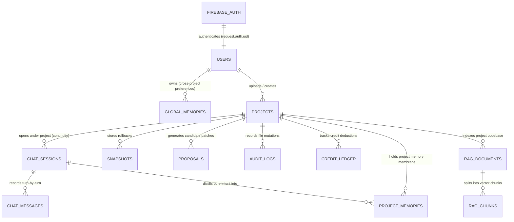
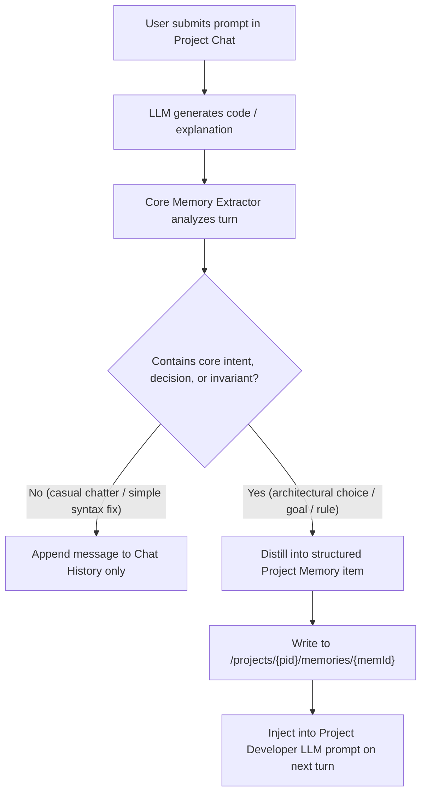

# Rewind — Firebase Database Architecture & Schema Specification

This document provides the complete database design, collection schemas, entity relationships, security rules, TypeScript interfaces, and bootstrap scripts required to run Rewind with multi-tenant **Firebase Authentication**, **Cloud Firestore**, and **Project-Scoped Chat & Memory Membrane**.

---

## 1. Architectural Overview & Entity Hierarchy

Firebase uses **Firebase Authentication** for identity and **Cloud Firestore** for hierarchical NoSQL persistence.

In this architecture:
1. **Root User Entity:** Every developer has a secure root document under `/users/{userId}`.
2. **Project-Scoped Chat Continuity:** Chat sessions do **NOT** float separately at a global level. Instead, **every chat session is scoped directly under the uploaded project** (`/users/{userId}/projects/{projectId}/chat_sessions/{sessionId}`). When a user switches to or uploads a project, that project's chat history, reasoning traces, and code revisions are preserved in place.
3. **The "Membrane" (Selective Core Memory Distillation):** The system does **not** dump entire raw chat transcripts into the LLM's permanent memory. Instead, an automated extraction pipeline identifies and distills **core user intentions, architectural decisions, and technical constraints** into a dedicated memory membrane (`/users/{userId}/projects/{projectId}/memories/{memoryId}`). This gives the Project Developer LLM crystal-clear understanding of what the user wants to accomplish without token bloat or conversational noise.



### Firestore Path Hierarchy Summary

```text
/users/{userId}                                                     [User profile & settings]
   ├── global_memories/{memoryId}                                   [Global developer coding preferences]
   └── projects/{projectId}                                         [Uploaded project workspace]
         ├── chat_sessions/{sessionId}                              [Project-scoped chat sessions]
         │     └── messages/{messageId}                             [Turn-by-turn chat history]
         ├── memories/{memoryId}                                    [Project Memory Membrane: Core Intentions]
         ├── snapshots/{snapshotId}                                 [Safety rollback checkpoints]
         ├── proposals/{proposalId}                                 [AI candidate patches & repairs]
         ├── audit_logs/{actionId}                                  [Immutable mutation trail]
         ├── credit_ledger/{taskId}                                 [Dual accounting deduplication]
         └── documents/{documentId}                                 [RAG indexed codebase files]
               └── chunks/{chunkId}                                 [Dense vector embeddings]
```

---

## 2. The Core Memory Distillation Pipeline ("The Membrane")

### Why Not Store All Chat Transcripts as Memory?
- **Conversational Noise:** Chat sessions are filled with pleasantries ("thanks", "can you check this line?"), intermediate syntax errors, debugging hypotheses, and dead-ends.
- **Context Window Saturation:** Storing full conversation logs quickly exceeds model context windows, increases latency, and degrades reasoning accuracy.
- **Lost Intentions:** Without distillation, critical instructions (e.g. *"Our backend must use SQLite and never use any external auth provider"*) get buried under hundreds of lines of code diffs.

### How the Memory Membrane Works
Whenever a chat turn occurs in `/projects/{projectId}/chat_sessions/{sessionId}`, the engine executes a 3-step extraction loop:



### Memory Categories Captured in the Membrane
1. `project_intent`: High-level purpose of the project (e.g., *"Building an offline-first markdown notes app with local SQLite"*).
2. `architectural_decision`: System design decisions (e.g., *"All state must be managed via Zustand; use Tailwind for styling"*).
3. `technical_constraint`: Hard boundaries and safety invariants (e.g., *"Never modify src/evaluator.ts without explicit permission"*).
4. `resolved_pattern`: Confirmed compiler error fixes or conventions agreed upon in chat (e.g., *"Always import icons as named exports"*).

---

## 3. Complete Firestore Collection Schemas

### 1. Root User Profile
- **Path:** `/users/{userId}`
- **Document ID:** `userId` (matches `request.auth.uid`)

| Field Name | Type | Required | Default | Description |
|---|---|:---:|---|---|
| `uid` | `string` | Yes | — | Firebase Auth UID |
| `email` | `string` | Yes | — | User email address |
| `displayName` | `string` | Yes | `""` | User's full display name |
| `photoURL` | `string` | No | `null` | Profile avatar URL |
| `role` | `string` | Yes | `"developer"` | `"admin" \| "developer" \| "viewer"` |
| `activeProjectId` | `string` | Yes | `"demo-workspace"` | Current active project workspace |
| `creditAllowance` | `number` | Yes | `100` | Free credit cap |
| `creditsUsed` | `number` | Yes | `0` | Cumulative credits consumed |
| `createdAt` | `timestamp` | Yes | `serverTimestamp()` | Registration date |
| `updatedAt` | `timestamp` | Yes | `serverTimestamp()` | Profile update date |

---

### 2. User Global Memories (Cross-Project Developer Preferences)
- **Path:** `/users/{userId}/global_memories/{memoryId}`
- **Document ID:** `memoryId` (`gmem_{timestamp}_{hash}`)

| Field Name | Type | Required | Description |
|---|---|:---:|---|
| `id` | `string` | Yes | Global memory identifier |
| `userId` | `string` | Yes | Owner UID |
| `category` | `string` | Yes | `"coding_preference" \| "general_rule" \| "tooling"` |
| `title` | `string` | Yes | Short summary (e.g. *"Prefer strict TypeScript types with no any"*) |
| `content` | `string` | Yes | Distilled rule text injected into all projects |
| `tags` | `array<string>` | Yes | e.g. `["typescript", "code-style"]` |
| `createdAt` | `timestamp` | Yes | Creation timestamp |
| `updatedAt` | `timestamp` | Yes | Last updated timestamp |

---

### 3. Uploaded Project Workspaces
- **Path:** `/users/{userId}/projects/{projectId}`
- **Document ID:** `projectId` (`proj_{slug}_{hash}`)

| Field Name | Type | Required | Description |
|---|---|:---:|---|
| `id` | `string` | Yes | Unique project ID (e.g. `demo-workspace`, `proj_video_editor`) |
| `name` | `string` | Yes | Display name |
| `description` | `string` | No | Project description |
| `workspacePath` | `string` | Yes | Local filesystem path |
| `template` | `string` | Yes | `"demo" \| "empty"` |
| `fileCount` | `number` | Yes | Number of tracked project files |
| `totalSizeBytes` | `number` | Yes | Total workspace size in bytes |
| `snapshotCount` | `number` | Yes | Number of recovery snapshots |
| `chatSessionCount` | `number` | Yes | Number of chat sessions under this project |
| `status` | `string` | Yes | `"active" \| "archived"` |
| `isDefault` | `boolean` | Yes | Whether this is the default workspace |
| `createdAt` | `timestamp` | Yes | Creation timestamp |
| `updatedAt` | `timestamp` | Yes | Last modified timestamp |

---

### 4. Project-Scoped Chat Sessions (Continuity Under Uploaded Project)
- **Path:** `/users/{userId}/projects/{projectId}/chat_sessions/{sessionId}`
- **Document ID:** `sessionId` (`sess_{timestamp}_{hash}`)

| Field Name | Type | Required | Description |
|---|---|:---:|---|
| `id` | `string` | Yes | Session ID |
| `projectId` | `string` | Yes | Parent project ID |
| `userId` | `string` | Yes | Owner UID |
| `title` | `string` | Yes | Topic summary (e.g. *"Refactoring Evaluator Invariants"*) |
| `activeModel` | `string` | Yes | Active model ID |
| `routingMode` | `string` | Yes | `"auto" \| "manual"` |
| `messageCount` | `number` | Yes | Number of turns in this session |
| `extractedMemoriesCount` | `number` | Yes | Count of core intentions distilled from this chat |
| `createdAt` | `timestamp` | Yes | Session start timestamp |
| `lastMessageAt` | `timestamp` | Yes | Timestamp of most recent message |

---

### 5. Chat Messages (Turn-by-Turn History Under Project Session)
- **Path:** `/users/{userId}/projects/{projectId}/chat_sessions/{sessionId}/messages/{messageId}`
- **Document ID:** `messageId` (`msg_{timestamp}_{hash}`)

| Field Name | Type | Required | Description |
|---|---|:---:|---|
| `id` | `string` | Yes | Message ID |
| `sessionId` | `string` | Yes | Parent session ID |
| `projectId` | `string` | Yes | Scoped project ID |
| `role` | `string` | Yes | `"user" \| "assistant" \| "system"` |
| `content` | `string` | Yes | Prompt or response text |
| `reasoning` | `string` | No | Assistant chain-of-thought rationale |
| `proposalId` | `string` | No | Linked `AIChangeProposal` ID if patch was generated |
| `containsCoreIntent` | `boolean` | Yes | True if a distilled memory was extracted from this message |
| `tokenUsage` | `map` | No | `{ promptTokens, completionTokens, totalTokens }` |
| `createdAt` | `timestamp` | Yes | Message creation timestamp |

---

### 6. Project Memory Membrane (Distilled Core Intentions & Architecture)
- **Path:** `/users/{userId}/projects/{projectId}/memories/{memoryId}`
- **Document ID:** `memoryId` (`pmem_{timestamp}_{hash}`)

| Field Name | Type | Required | Description |
|---|---|:---:|---|
| `id` | `string` | Yes | Unique project memory ID |
| `projectId` | `string` | Yes | Scoped project ID |
| `userId` | `string` | Yes | Owner UID |
| `sourceSessionId` | `string` | No | ID of chat session where intent was articulated |
| `sourceMessageId` | `string` | No | ID of specific chat turn |
| `category` | `string` | Yes | `"project_intent" \| "architectural_decision" \| "technical_constraint" \| "resolved_pattern"` |
| `title` | `string` | Yes | Short summary (e.g. *"Offline-First SQLite Storage"*) |
| `distilledIntent` | `string` | Yes | Clean, distilled user intention / requirement for the LLM |
| `importance` | `number` | Yes | Importance rating (`1` to `5`) |
| `tags` | `array<string>` | Yes | e.g. `["database", "offline", "sqlite"]` |
| `isActive` | `boolean` | Yes | Whether this memory is currently injected into prompts |
| `createdAt` | `timestamp` | Yes | Extraction timestamp |
| `updatedAt` | `timestamp` | Yes | Last updated timestamp |

---

### 7. Recovery Snapshots
- **Path:** `/users/{userId}/projects/{projectId}/snapshots/{snapshotId}`
- **Document ID:** `snapshotId` (`snap_{timestamp}_{hash}`)

| Field Name | Type | Required | Description |
|---|---|:---:|---|
| `id` | `string` | Yes | Snapshot ID |
| `workspaceId` | `string` | Yes | Project ID |
| `name` | `string` | Yes | Snapshot label (e.g. *"Pre-AI Proposal Apply"*) |
| `description` | `string` | No | Trigger reason |
| `totalFiles` | `number` | Yes | Tracked file count |
| `totalBytes` | `number` | Yes | Total bytes |
| `files` | `array<map>` | Yes | `[{ path, hash, size, modifiedAt }]` |
| `createdAt` | `timestamp` | Yes | Snapshot timestamp |

---

### 8. AI Change Proposals & Self-Repair Audit
- **Path:** `/users/{userId}/projects/{projectId}/proposals/{proposalId}`
- **Document ID:** `proposalId` (`prop_{timestamp}_{hash}`)

| Field Name | Type | Required | Description |
|---|---|:---:|---|
| `id` | `string` | Yes | Proposal ID |
| `model` | `string` | Yes | Model ID used |
| `userPrompt` | `string` | Yes | Original prompt |
| `summary` | `string` | Yes | Summary of change |
| `reasoning` | `string` | Yes | Model rationale |
| `modifications` | `array<map>` | Yes | `[{ path, operation, replacementContent, expectedCurrentHash, unifiedDiff }]` |
| `verificationStatus` | `string` | Yes | `"verified" \| "verification_failed" \| "repair_exhausted"` |
| `verifiedInSandbox` | `boolean` | Yes | True if passed isolated sandbox compiler & invariant checks |
| `repairAttemptsCount`| `number` | Yes | Count of compiler self-repairs executed (`0-2`) |
| `status` | `string` | Yes | `"pending_approval" \| "approved" \| "applied" \| "rejected"` |
| `snapshotBeforeId` | `string` | No | Pre-apply safety snapshot ID |
| `appliedAt` | `timestamp` | No | Apply execution timestamp |
| `createdAt` | `timestamp` | Yes | Proposal creation timestamp |

---

### 9. Application Audit Trail
- **Path:** `/users/{userId}/projects/{projectId}/audit_logs/{actionId}`
- **Document ID:** `actionId` (`act_{timestamp}_{hash}`)

| Field Name | Type | Required | Description |
|---|---|:---:|---|
| `id` | `string` | Yes | Action ID |
| `actionType` | `string` | Yes | `"snapshot_create" \| "file_modify" \| "file_upload" \| "restore" \| "validate"` |
| `summary` | `string` | Yes | Event description |
| `status` | `string` | Yes | `"success" \| "failure"` |
| `targetPath` | `string` | No | Target file path |
| `snapshotIdBefore` | `string` | No | Pre-state snapshot ID |
| `snapshotIdAfter` | `string` | No | Post-state snapshot ID |
| `details` | `map` | No | Action metadata |
| `timestamp` | `timestamp` | Yes | Event timestamp |

---

### 10. Dual Accounting & Credit Ledger
- **Path:** `/users/{userId}/projects/{projectId}/credit_ledger/{taskId}`
- **Document ID:** `taskId` (idempotency key)

| Field Name | Type | Required | Description |
|---|---|:---:|---|
| `taskId` | `string` | Yes | Task ID hash |
| `creditsCharged` | `number` | Yes | Rewind credits deducted (`1-5`) |
| `complexity` | `string` | Yes | Complexity classification |
| `providerCostUSD` | `number` | Yes | USD cost |
| `costStatus` | `string` | Yes | `"confirmed" \| "estimated" \| "unavailable"` |
| `tokenUsage` | `map` | Yes | `{ promptTokens, completionTokens, totalTokens }` |
| `modelId` | `string` | Yes | Model ID |
| `chargedAt` | `timestamp` | Yes | Deduction timestamp |

---

### 11. RAG Documents & Vector Chunks
- **Documents Path:** `/users/{userId}/projects/{projectId}/documents/{documentId}`
- **Chunks Path:** `/users/{userId}/projects/{projectId}/documents/{documentId}/chunks/{chunkId}`

| Document Field | Type | Description |
|---|---|---|
| `id` | `string` | Document ID (`doc_xxxx`) |
| `fileName` | `string` | Relative path in project workspace (e.g. `src/evaluator.ts`) |
| `mimeType` | `string` | File MIME type |
| `sizeBytes` | `number` | File size |
| `chunkCount` | `number` | Total chunks generated |
| `status` | `string` | `"indexed" \| "processing" \| "failed"` |
| `embeddingModel`| `string` | Embedding model identifier |
| `createdAt` | `timestamp` | Indexing timestamp |

| Chunk Field | Type | Description |
|---|---|---|
| `chunkId` | `string` | Chunk ID (`chk_xxxx`) |
| `docId` | `string` | Parent document ID |
| `chunkIndex` | `number` | Chunk sequence index (`0, 1, 2...`) |
| `text` | `string` | Chunk text content |
| `vector` | `array<number>` | Normalized dense vector embedding |
| `charCount` | `number` | Character length |
| `createdAt` | `timestamp` | Chunk timestamp |

---

## 4. Cloud Firestore Security Rules (`firestore.rules`)

These rules guarantee that chat sessions, memory membranes, and project data are strictly accessible only by their owning developer:

```javascript
rules_version = '2';
service cloud.firestore {
  match /databases/{database}/documents {

    // Helper functions
    function isAuthenticated() {
      return request.auth != null;
    }

    function isOwner(userId) {
      return isAuthenticated() && request.auth.uid == userId;
    }

    // 1. Root User Profile
    match /users/{userId} {
      allow read, write: if isOwner(userId);

      // 2. Global Developer Memories (Cross-Project)
      match /global_memories/{memoryId} {
        allow read, write: if isOwner(userId);
      }

      // 3. Uploaded Project Workspaces
      match /projects/{projectId} {
        allow read, write: if isOwner(userId);

        // Project-Scoped Chat Sessions (Continuity under project)
        match /chat_sessions/{sessionId} {
          allow read, write: if isOwner(userId);

          // Turn-by-turn chat messages
          match /messages/{messageId} {
            allow read, write: if isOwner(userId);
          }
        }

        // Project Memory Membrane (Distilled user intentions & architecture)
        match /memories/{memoryId} {
          allow read, write: if isOwner(userId);
        }

        // Recovery Snapshots
        match /snapshots/{snapshotId} {
          allow read, write: if isOwner(userId);
        }

        // AI Candidate Proposals
        match /proposals/{proposalId} {
          allow read, write: if isOwner(userId);
        }

        // Audit Trail Logs
        match /audit_logs/{actionId} {
          allow read, write: if isOwner(userId);
        }

        // Dual Accounting Credit Ledger
        match /credit_ledger/{taskId} {
          allow read, write: if isOwner(userId);
        }

        // RAG Codebase Documents & Vector Chunks
        match /documents/{documentId} {
          allow read, write: if isOwner(userId);

          match /chunks/{chunkId} {
            allow read, write: if isOwner(userId);
          }
        }
      }
    }

    // Default deny all other access
    match /{document=**} {
      allow read, write: if false;
    }
  }
}
```

---

## 5. Firestore Composite Indexes (`firestore.indexes.json`)

```json
{
  "indexes": [
    {
      "collectionGroup": "chat_sessions",
      "queryScope": "COLLECTION",
      "fields": [
        { "fieldPath": "projectId", "order": "ASCENDING" },
        { "fieldPath": "lastMessageAt", "order": "DESCENDING" }
      ]
    },
    {
      "collectionGroup": "memories",
      "queryScope": "COLLECTION",
      "fields": [
        { "fieldPath": "isActive", "order": "ASCENDING" },
        { "fieldPath": "importance", "order": "DESCENDING" }
      ]
    },
    {
      "collectionGroup": "snapshots",
      "queryScope": "COLLECTION",
      "fields": [
        { "fieldPath": "workspaceId", "order": "ASCENDING" },
        { "fieldPath": "createdAt", "order": "DESCENDING" }
      ]
    },
    {
      "collectionGroup": "proposals",
      "queryScope": "COLLECTION",
      "fields": [
        { "fieldPath": "status", "order": "ASCENDING" },
        { "fieldPath": "createdAt", "order": "DESCENDING" }
      ]
    },
    {
      "collectionGroup": "audit_logs",
      "queryScope": "COLLECTION",
      "fields": [
        { "fieldPath": "actionType", "order": "ASCENDING" },
        { "fieldPath": "timestamp", "order": "DESCENDING" }
      ]
    }
  ],
  "fieldOverrides": []
}
```

---

## 6. TypeScript Document Interfaces (`src/types/firebase.ts`)

```typescript
import type { Timestamp } from "firebase-admin/firestore";

export interface UserProfileDoc {
  uid: string;
  email: string;
  displayName: string;
  photoURL?: string | null;
  role: "admin" | "developer" | "viewer";
  activeProjectId: string;
  creditAllowance: number;
  creditsUsed: number;
  createdAt: Timestamp;
  updatedAt: Timestamp;
}

export interface UserGlobalMemoryDoc {
  id: string;
  userId: string;
  category: "coding_preference" | "general_rule" | "tooling";
  title: string;
  content: string;
  tags: string[];
  createdAt: Timestamp;
  updatedAt: Timestamp;
}

export interface ProjectDoc {
  id: string;
  name: string;
  description?: string;
  workspacePath: string;
  template: "demo" | "empty";
  fileCount: number;
  totalSizeBytes: number;
  snapshotCount: number;
  chatSessionCount: number;
  status: "active" | "archived";
  isDefault: boolean;
  createdAt: Timestamp;
  updatedAt: Timestamp;
}

export interface ChatSessionDoc {
  id: string;
  projectId: string;
  userId: string;
  title: string;
  activeModel: string;
  routingMode: "auto" | "manual";
  messageCount: number;
  extractedMemoriesCount: number;
  createdAt: Timestamp;
  lastMessageAt: Timestamp;
}

export interface ChatMessageDoc {
  id: string;
  sessionId: string;
  projectId: string;
  role: "user" | "assistant" | "system";
  content: string;
  reasoning?: string;
  proposalId?: string;
  containsCoreIntent: boolean;
  tokenUsage?: {
    promptTokens: number;
    completionTokens: number;
    totalTokens: number;
  };
  createdAt: Timestamp;
}

export interface ProjectMemoryDoc {
  id: string;
  projectId: string;
  userId: string;
  sourceSessionId?: string;
  sourceMessageId?: string;
  category: "project_intent" | "architectural_decision" | "technical_constraint" | "resolved_pattern";
  title: string;
  distilledIntent: string;
  importance: number; // 1 to 5
  tags: string[];
  isActive: boolean;
  createdAt: Timestamp;
  updatedAt: Timestamp;
}

export interface SnapshotDoc {
  id: string;
  workspaceId: string;
  name: string;
  description?: string;
  totalFiles: number;
  totalBytes: number;
  files: Array<{
    path: string;
    hash: string;
    size: number;
    modifiedAt: string;
  }>;
  createdAt: Timestamp;
}

export interface ProposalDoc {
  id: string;
  model: string;
  userPrompt: string;
  summary: string;
  reasoning: string;
  modifications: Array<{
    path: string;
    operation: "modify" | "create" | "delete";
    replacementContent: string;
    expectedCurrentHash?: string;
    unifiedDiff?: string;
  }>;
  verificationStatus: "verified" | "verification_failed" | "repair_exhausted";
  verifiedInSandbox: boolean;
  repairAttemptsCount: number;
  status: "pending_approval" | "approved" | "applied" | "rejected";
  snapshotBeforeId?: string;
  appliedAt?: Timestamp;
  createdAt: Timestamp;
}

export interface CreditLedgerDoc {
  taskId: string;
  creditsCharged: number;
  complexity: string;
  providerCostUSD: number;
  costStatus: "confirmed" | "estimated" | "unavailable";
  tokenUsage: {
    promptTokens: number;
    completionTokens: number;
    totalTokens: number;
  };
  modelId: string;
  chargedAt: Timestamp;
}
```

---

## 7. Automated Database Bootstrap Script (`scripts/bootstrap-firebase.ts`)

```typescript
import { initializeApp, cert, getApps } from "firebase-admin/app";
import { getFirestore, FieldValue } from "firebase-admin/firestore";

if (!getApps().length) {
  initializeApp({
    projectId: process.env.FIREBASE_PROJECT_ID,
    credential: process.env.FIREBASE_CLIENT_EMAIL && process.env.FIREBASE_PRIVATE_KEY
      ? cert({
          projectId: process.env.FIREBASE_PROJECT_ID,
          clientEmail: process.env.FIREBASE_CLIENT_EMAIL,
          privateKey: process.env.FIREBASE_PRIVATE_KEY.replace(/\\n/g, "\n"),
        })
      : undefined,
  });
}

const db = getFirestore();

export async function bootstrapUserDatabase(userId: string, email: string, displayName: string) {
  console.log(`[Firebase Bootstrap] Setting up collections for user: ${userId}`);

  const userRef = db.collection("users").doc(userId);

  // 1. User Profile Document
  await userRef.set(
    {
      uid: userId,
      email,
      displayName,
      role: "developer",
      activeProjectId: "demo-workspace",
      creditAllowance: 100,
      creditsUsed: 0,
      createdAt: FieldValue.serverTimestamp(),
      updatedAt: FieldValue.serverTimestamp(),
    },
    { merge: true }
  );

  // 2. Global Developer Preferences
  const globalMemRef = userRef.collection("global_memories").doc("gmem_default_rules");
  await globalMemRef.set({
    id: "gmem_default_rules",
    userId,
    category: "coding_preference",
    title: "TypeScript Strict Invariants",
    content: "All proposals must strictly verify TypeScript types and prevent eval() or shell execution sinks.",
    tags: ["security", "typescript"],
    createdAt: FieldValue.serverTimestamp(),
    updatedAt: FieldValue.serverTimestamp(),
  });

  // 3. Default Workspace Project
  const projectRef = userRef.collection("projects").doc("demo-workspace");
  await projectRef.set({
    id: "demo-workspace",
    name: "Demo Project (NVIDIA Recovery)",
    description: "Default workspace containing agent workflow, runtime config, and evaluator.",
    workspacePath: "demo-workspace",
    template: "demo",
    fileCount: 4,
    totalSizeBytes: 12500,
    snapshotCount: 0,
    chatSessionCount: 1,
    status: "active",
    isDefault: true,
    createdAt: FieldValue.serverTimestamp(),
    updatedAt: FieldValue.serverTimestamp(),
  });

  // 4. Initial Chat Session Nested Under Project
  const sessionRef = projectRef.collection("chat_sessions").doc("sess_welcome");
  await sessionRef.set({
    id: "sess_welcome",
    projectId: "demo-workspace",
    userId,
    title: "Welcome & Project Introduction",
    activeModel: "nvidia/nemotron-3.5-lightning-30b-a3b",
    routingMode: "auto",
    messageCount: 1,
    extractedMemoriesCount: 1,
    createdAt: FieldValue.serverTimestamp(),
    lastMessageAt: FieldValue.serverTimestamp(),
  });

  // 5. Initial Chat Message Under Session
  await sessionRef.collection("messages").doc("msg_welcome").set({
    id: "msg_welcome",
    sessionId: "sess_welcome",
    projectId: "demo-workspace",
    role: "assistant",
    content: "Welcome to Rewind! I am your Project Developer AI. Ask me to refactor code, fix compiler errors, or inspect project invariants.",
    containsCoreIntent: true,
    createdAt: FieldValue.serverTimestamp(),
  });

  // 6. Project Memory Membrane (Distilled Project Core Intention)
  await projectRef.collection("memories").doc("pmem_demo_intent").set({
    id: "pmem_demo_intent",
    projectId: "demo-workspace",
    userId,
    sourceSessionId: "sess_welcome",
    category: "project_intent",
    title: "Rewind Agent Workflow Self-Repair",
    distilledIntent: "Maintain determinism and type safety across agent-workflow.json, evaluator.ts, and config/runtime.json.",
    importance: 5,
    tags: ["invariants", "evaluator"],
    isActive: true,
    createdAt: FieldValue.serverTimestamp(),
    updatedAt: FieldValue.serverTimestamp(),
  });

  console.log(`[Firebase Bootstrap] Collections initialized successfully for ${userId}!`);
}
```
